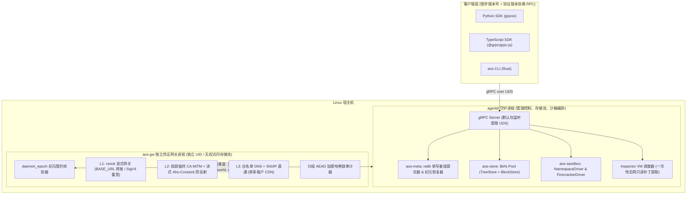

# Forkloom (`agentd`) 核心运行时架构与研发规划书（v2.1 · Gate 1 修订定稿）

> **文档状态**：Architecture & Roadmap Specification **v2.1**（已闭环首轮三大结构性硬伤，并合入红队 `fsck` Gate 1 复审全部强制修订项 A1~A7）  
> **所属仓库**：`forkloom-vm/forkloom`（核心主仓）  
> **系统定位**：运行在 Linux 内核之上的单机高密度有状态沙箱与整机运行态分叉运行时（Stateful Sandbox & VM Forking Runtime）

---

## 0. v1.0 -> v2.1 核心架构修正记录（显式撤回与加固）

| 原设计表述 | v2.1 最终架构决策 | 工程与内核事实依据 |
| :--- | :--- | :--- |
| 统一 `MountedView` 传给 Namespace 与 Firecracker | **彻底撤回**。在 Rust 类型层拆分为 `TreeStore`（目录树，服务 Namespace 冷分叉）与 `BlockStore`（块镜像，服务 Firecracker `virtio-blk` 热分叉） | Firecracker 无 `virtio-fs`，仅支持块设备；两者文件系统元数据所有权分属宿主内核与访客内核。 |
| 活宿主目录挂 `OverlayFS` / Phase 2 自研 `FUSE` | **彻底撤回**。全面弃用 `OverlayFS`，冻结自研 `FUSE`；采用**独立 Btrfs 存储池（子卷快照 + 稀疏 `ext4` 块镜像 `FICLONE` reflink）**，备选 `XFS reflink` 块后端 | 活目录做 `lowerdir` 属内核未定义行为；本地工作区导入统一改为 tar 流安全解包成不可变 Base 子卷；`Turso AgentFS` GitHub Issue `#228` 已证实 FUSE+SQLite 在多核编译下存在约 10x 性能瓶颈。 |
| `FrameId` = 全盘 `blake3` Merkle Root | **撤回**。`FrameId` 改为随机 128-bit ID（不依赖时钟排序，血统完全由显式 `parent` 指针表达） | 全盘求哈希是 $O(\text{数据量})$，且 WSL2 休眠唤醒存在时钟跳变，不依赖单调时间戳排血统。 |
| 基于请求指纹命中的“LLM 确定性重放” | **撤回确定性承诺**。改为**快照闪回 + 分段加密 I/O 审计日志 + 回归测试按序录制回放（发散即报错 `Divergence`）** | 工具输出任意时间戳/PID 差异都会导致后续 LLM 请求指纹失效；状态回退直接靠恢复 `Frame`。 |
| `Staged` 状态崩溃前滚（Roll-forward） | **撤回前滚（A4）**。恢复规则极简化：**凡非 `Committed` 状态的帧在恢复时一律回滚清理**，客户端凭幂等 `RequestId` 重试 | 稀疏内存文件长度无法检测撕裂写，前滚会静默恢复损坏的 VM，且破坏 `T3` 唯一提交点不变式。 |
| 18 个月含三路合并、CRIU、Web UI、分布式集群 | **全部移出 18 个月主线**。源码合并交由 `git`；SDK 用 gRPC 瘦客户端替代 `napi-rs`；专注打穿单机高可靠运行时 | 将 6~10 人年范围收敛至 1~2 名精锐架构师可高质量交付的核心壁垒。 |

---

## 一、全球竞品真实边界与破局定位

基于公开文档、源码仓库与社区 Issue 核查（基准：2026 年）：

| 竞品 | 底层隔离与存储架构 | 已核实的架构边界与局限 | `Forkloom` 的差异化切入点 |
| :--- | :--- | :--- | :--- |
| **Morph Cloud** (`Infinibranch`) | 闭源 `MorphVM` + 闭源存算分离 `MorphFS` | 核心运行时完全闭源，不支持私有化单机自托管；公开文档未披露出网凭证防反射机制与冷热边界条件。 | **Apache-2.0 开源单机自托管运行时**，面向科研实验室与企业内网自有裸金属大内存服务器零外部重依赖部署。 |
| **Fly.io Sprites** | Firecracker + 自研 `SBD`（S3 over NBD + `ext4`，见 `fly.io/blog/sprites-block-device`） | 官方 Checkpoints 文档写明**仅保存磁盘层、不含运行态内存与进程**（恢复需重启 VM）；公开 API/CLI 缺失从快照 `fork` 的原生接口（见 Fly Community `#27838`）。 | 原生提供 **`fork(N)` 整机运行态热分叉**（同步捕获内存与块设备），保留已预热进程与 Guest 内本地回环连接。 |
| **E2B** (`e2b-dev/runtime`) | Firecracker + `userfaultfd` 内存懒加载 + CoW rootfs | 单机自托管（`embed/`）仍需编排 PostgreSQL、Redis、ClickHouse、Orchestrator 等多个外部组件；`e2b-dev/infra#1421` 等讨论反映守护进程异常退出时存在残留 VM/`veth` 清理难题。 | **零外部数据库依赖**（内嵌 `redb` ACID 状态机）；通过 `daemon_epoch` 纪元围栏在守护进程重启时确定性清剿残留资源。 |
| **Turso AgentFS** (`tursodatabase/agentfs`) | `fuser` (FUSE) + 单文件 `SQLite/libSQL` + `unshare` | 共享宿主机内核、无网络隔离与内存快照；受 FUSE 跨态同步与 SQLite 单写锁制约，多核构建（如 `make -j10`）存在显著写吞吐退化（见 `agentfs#228`）。 | 直接使用内核原生文件系统（Btrfs 子卷 / `virtio-blk` 原生 `ext4`），零 FUSE 转发开销，配齐 KVM 硬件隔离。 |
| **Dagger `container-use`** | Docker/BuildKit 容器 + 本地 `git worktree` MCP | 共享内核容器隔离，密钥在容器内直接解析，无防注入出网网关，无内存态快照分叉。 | 将 MCP 定位为上层轻量生态适配器，底层专注构建微虚拟机热分叉与宿主机侧凭证网关。 |

---

## 二、核心概念模型与系统进程边界

### 2.1 四个核心原语与持久性契约
1. **`World`（运行实例）**：绑定特定驱动（`Namespace` 半可信冷实例 或 `Firecracker` 不可信微虚拟机实例）的活动沙箱，独占可写根卷与独立网络命名空间。**明确契约：运行态 `World` 不跨 `agentd` 重启存活；需要跨重启保留的状态必须显式提交为 `Durable Frame`。**
2. **`Frame`（不可变状态帧）**：由 128-bit ID 与显式 `parent: Option<FrameId>` 构成血统 DAG。严格区分两类持久性等级（**A1~A3 修订**）：
   - **`Durable Frame`（落盘持久帧）**：全部产物（只读子卷，或块镜像 + 内存镜像 + `vmstate`）均落入持久化存储池并完成 `fsync`，跨宿主机断电重启可恢复（受相同 Firecracker 版本、Guest 内核摘要与兼容 CPU 特性约束，元数据记录版本指纹并在恢复时强校验）。
   - **`Volatile Frame`（易失高速帧，仅用于单次开机内的 RL/MCTS 高频树搜索）**：内存镜像存放于受严格配额限制的独立 `tmpfs` 挂载点（如 `mount -t tmpfs -o size=<budget>`，耗尽时显式返回 `ResourceExhausted` 错误，绝不触发宿主机内核 OOM），磁盘仍用存储池 `FICLONE`。
   - **跨级铁律**：任何帧的持久性等级不得高于其物理依赖的任何产物；**严禁持久 `Timeline` 的头指针指向 `Volatile Frame`**；从 `Volatile` 父帧派生 `Durable` 子帧时，必须将完整内存镜像拷贝落盘至存储池并完成 `fsync`（耗时与 Guest 内存大小及磁盘写带宽成正比）。每个已封存的内存镜像文件均为自包含只读文件，**严禁对任何已封存 `mem` 文件做原地修改**（防止破坏正通过 `MAP_PRIVATE` 映射该文件的运行中克隆实例）。
3. **`Timeline`（持久时间线指针）**：仅允许指向已提交的 `Durable Frame`，通过 `redb` 事务原子 CAS 推进。
4. **`Capability`（网络与凭证契约）**：绑定 `(net_slot, world_id, daemon_epoch)` 三元组的出网路由策略、流量配额与外部凭证代填规则。

### 2.2 宿主机最小权限双进程架构



---

## 三、`aos-store`：双模类型安全存储引擎

### 3.1 存储池布局与默认属性（合入 `fsck` 审查修正）
在 `/var/lib/forkloom/pool` 挂载独立 **Btrfs 存储池**（备选 `XFS reflink` 作为纯块模式后端）：
- **块镜像默认保留 Btrfs CoW 与数据校验和**：不使用全局镜像 `NOCOW`（因为 `NOCOW` 文件一旦执行 `FICLONE` 共享，首次覆盖写依然触发 CoW，却永久丧失数据块校验和）；具体 extent 碎片对 `FICLONE` 耗时的影响由 Phase 0 实测数据裁决是否切换 `XFS` 块后端。
- **`meta/` 分盘存放（以 `HANDOFF.md` Phase 0 实测转向定论为准）**：`forkloom.redb` **存放于 Btrfs 数据池之外**的独立宿主机 `ext4/XFS` 目录（如 `/var/lib/forkloom/meta/forkloom.redb`），**不再放入 `/var/lib/forkloom/pool/` Btrfs 池内**（F0-1 实测同池快照全局事务使 `redb` 提交 P99 显著升高；F0-4 实测池写满 `ENOSPC` 时同池删除事务 100% 失败）。`meta/` 目录**严禁**对其创建子卷快照或 reflink；其所在宿主文件系统若为 `ext4/XFS` 则无需 `NOCOW` 处理，池内 `pool/` 仅存放受管对象与 `quarantine/`。
- **防死锁压舱石与池护栏**：启动时强制检查禁用 `qgroups` 与 `autodefrag`；预分配 `ballast` 压舱文件（生产 `2GiB`，WSL2 小池按比例配置），并在 Phase 0 验证池满释放压舱文件后 `redb` 删除事务可正常提交。

### 3.2 OCI 镜像与本地目录的不可变导入
1. **OCI 镜像导入**：拉取层摘要校验后，在独立 `userns + mountns + seccomp` 解包进程内使用 `openat2(RESOLVE_IN_ROOT | RESOLVE_NO_MAGICLINKS)` 逐层解包为只读 Btrfs 子卷链。
2. **本地工作区导入（替代原活目录挂载）**：CLI / MCP 将宿主本地 Git 工作区打包为可信 tar 流传入 `agentd`，走同一安全解包管线生成不可变 `Base Frame`，彻底杜绝直接挂载宿主活目录。
3. **块镜像物化（`Tree -> Block`）**：在与解包**完全一致的 `userns` UID/GID 映射上下文**内执行 `mkfs.ext4 -d <subvol>` 生成稀疏块镜像（避免容器内文件属主偏移），明确声明物化过程为整盘写入，耗时与实际文件总字节数成正比（仅在首次导入模板时发生一次，后续分叉均走 `FICLONE`）。

### 3.3 存储持久性类型区分（修正 A1）
在类型系统中显式区分落盘持久证明 `Persisted<T>` 与本机当次开机有效证明 `Ephemeral<T>`（携带 `boot_id`）：

```rust
pub mod kind {
    pub enum Tree {}   // 宿主内核拥有元数据（Namespace 冷分叉）
    pub enum Block {}  // 访客内核拥有原始块元数据（Firecracker 热分叉，宿主严禁 mount）
}

/// 落盘屏障证明：已完成 fsync(file) + fsync(parent_dir) 或 Btrfs 同步快照提交
pub struct Persisted<T>(T);
/// 易失内存证明：存放于受配额管控的 tmpfs，绑定当前宿主 /proc/sys/kernel/random/boot_id
pub struct Ephemeral<T> { inner: T, boot_id: u128 }
```

### 3.4 零信任补丁导出与双路径强校验
无论是 `TreeStore`、工作 VM 内快速自报路径（`GuestReported`），还是基于一次性无网微虚拟机的 `InspectorVm` 路径，**凡来自沙箱的补丁流一律封装为 `Untrusted<PatchBundle>` 并强制通过同一宿主侧校验器**：
- 拒绝任何包含 `..`、绝对路径、NUL 字节、符号链接逃逸或触碰 `.git/` 内部目录的变更条目；
- 检测并拒绝**大小写折叠冲突路径**（如同时新增 `Foo.ts` 与 `foo.ts`），确保补丁在 Windows / macOS 宿主机应用时安全无损；
- **帧落盘清洁度强校验（修正 A6b）**：仅标记为 `DiskClean`（捕获前已在冻结态完成 Guest `syncfs`）的块镜像允许送入 `InspectorVm` 提取磁盘 Diff；对未刷盘帧调用 `InspectorVm` 直接返回明确错误，杜绝因数据滞留 Guest 页缓存导致补丁静默漏文件。

---

## 四、`aos-meta`：唯一提交点、无前滚恢复与隔离区安全 GC

### 4.1 写入顺序与状态转换不变式（修正 A1 ~ A4）
1. **I1 意图先行**：创建任何池对象或 `tmpfs` 文件前，先在 `redb`（组提交 Actor，`Durability::Immediate` + 两阶段提交）写入 `T1: FrameState::Preparing { intent, durability, boot_id }`。
2. **I2 存储等级对齐**：`Durable` 帧的所有产物必须持有 `Persisted<T>`；`Volatile` 帧允许 `mem` 持有当前 `boot_id` 的 `Ephemeral<MemImage>`，但其父帧与关联磁盘对象不得反向被任何 `Durable` 帧依赖。
3. **I3 单点原子提交（废除 Staged 前滚）**：产物就绪后，在单一事务 `T2` 中原子完成 `Preparing -> Committed`、更新 `Hold` 集合（`Pin` 类型强制附带 `lease_until` 租约防客户端死锁泄漏）、可选推进 `Timeline` CAS（仅限 `Durable` 帧）及记录幂等 `RequestId`。
4. **I4 崩溃恢复铁律（唯回滚原则）**：启动恢复时，**任何状态不是 `Committed`（即处于 `Preparing`）的帧无条件回滚销毁**，绝不尝试猜测稀疏内存文件完整性做前滚。

### 4.2 安全启动恢复与防误删孤儿隔离（R0 ~ R9，修正 A1 / A5 / A7）
1. **R0 池防呆与空库保护（A5）**：获取 `pool/.lock`（校验池与外置 `meta/` 的 `POOL_UUID` 配对）；**若池 `objects/` 目录非空而独立宿主机 `meta/forkloom.redb`（位于 Btrfs 池之外，如 `/var/lib/forkloom/meta/forkloom.redb`）缺失或损坏无法打开，立即拒绝启动并报警**（严禁自动初始化新空库后触发孤儿清扫误删全池数据！）；校验 `POOL_UUID` 一致。
2. **R1 纪元递增与跨重启 `Volatile` 失效（A1）**：读取宿主 `/proc/sys/kernel/random/boot_id`；`daemon_epoch += 1` 写入 `redb`。若检测到 `boot_id` 与上一纪元不同，立即将所有 `Volatile` 状态的 `Committed` 帧批量置为 `Expired`，移除其全部 `Hold` 并排队回收其磁盘克隆文件。
3. **R2 旧纪元进程与网关围栏清剿（A7）**：
   - **网关纪元围栏**：首先连接 `aos-gw` 下发新 `daemon_epoch`，强制 `aos-gw` 立即作废所有 `< current_epoch` 的 `(slot, world, epoch)` 凭证绑定并清空对应连接状态，收到确认后方继续；
   - **进程树全歼**：所有沙箱与 `jailer` 子进程在创建时均通过 `clone3(CLONE_INTO_CGROUP)` 直接放入 `/sys/fs/cgroup/forkloom.slice/epoch-<e>/w-<id>`，恢复时对旧纪元 cgroup 写入 `cgroup.kill` 确保零漏网进程；回收网络槽位并执行 `conntrack -D` 清空残留连接跟踪表；将旧纪元活动 `World` 置为 `Lost`。
4. **R3~R5 确定性清理**：回滚全部 `Preparing` 帧，续完所有 `Deleting` 帧的物理删除。
5. **R6 带隔离区与熔断阈值的孤儿回收（A5）**：扫描 `objects/` 中不在活跃集合内的受管命名对象——**若孤儿对象数量超过安全阈值（如 > 50 个或占池总对象 > 10%），立即中止自动清理并拒绝启动，提示人工核查是否误恢复了旧版 `redb` 备份**；阈值内的少量崩溃孤儿先 `rename` 移入 `pool/quarantine/<epoch>/` 保留宽限期（如 24 小时）后再异步物理销毁。

---

## 五、`aos-sandbox`：确定性捕获顺序与热分叉协议

### 5.1 严格线性的热快照捕获顺序（修正 A6）
彻底消除异步块 I/O 与客体页缓存竞态，热 Checkpoint 严格按以下串行步骤执行：
1. **Step 1（客体冻结与刷盘）**：`agentd` 经 `vsock` 通知母 VM 内 `aos-guest` 执行可选 `pre_freeze` 钩子 -> 置 `aos.workload/cgroup.freeze = 1` 并轮询 `cgroup.events` 确认 `frozen == 1` -> 默认执行 `syncfs()` 将客体脏页刷入块设备 -> 返回 `FrozenAck { disk_clean: true }`。
2. **Step 2（暂停 VMM）**：调用 Firecracker `PATCH /vm { state: "Paused" }`（此时虚拟 CPU 停止，无新块请求产生）。
3. **Step 3（排空并生成 VM 快照）**：调用 `PUT /snapshot/create` 写出 `vmstate` 与 `mem` 文件（确保 VMM 在途块 I/O 完全排空落盘）。
4. **Step 4（克隆块镜像并持久化）**：对已静止且排空的根块镜像执行 `ioctl(FICLONE)` 生成封存盘 `f-<id>-disk.img`，随后对 `mem`、`vmstate`、`disk.img` 及其父目录执行 `fsync` 拿到 `Persisted<T>`（或 `Volatile` 模式下的 `Ephemeral<MemImage>`），最后提交 `redb` 事务 `T2`。

> **注（Namespace 冷分叉 seccomp 细节）**：`NamespaceDriver` 拦截 `BTRFS_IOCTL_MAGIC` 防止容器内建子卷时，规则必须设为返回 `EOPNOTSUPP` 错误码而非 `SECCOMP_RET_KILL`，确保容器内 `cp` 等标准工具在尝试 `FICLONE` 受阻时能平滑回退到常规拷贝。

### 5.2 热分叉恢复与重播种握手
- **宿主安全不依赖客体配合**：网络隔离、槽位 `nftables` 防火墙、`memory.max` 限制及网关 `(slot, world, epoch)` 凭证围栏全部在宿主机侧强制生效；即便不可信 Guest 篡改或杀死了 `aos-guest`，最多导致分叉握手超时（默认 2s）被宿主机判定失败销毁，绝不危及宿主机或其他沙箱安全。
- **正常握手流**：VMM 以 `MAP_PRIVATE` 共享映射只读 `mem` 文件（配合 `fadvise(WILLNEED)` 预热工作集）恢复运行 -> `VMGenID` 触发内核重播种 -> `aos-guest` 重连 `vsock` 注入宿主机 64 字节真随机熵并执行 `RNDRESEEDCRNG`、校准 `CLOCK_REALTIME`、调用 `ss -K` 断开失效外网 TCP 连接（保留 Guest 内 `127.0.0.1` 数据库等回环连接，前提为 Guest 内核开启 `CONFIG_INET_DIAG_DESTROY`）-> 解冻 `aos.workload` 正式就绪。

---

## 六、`aos-gw`：凭证网关与加密审计边界

1. **三层出网管控**：
   - **L1 显式网关（主路径）**：沙箱内通过本地代理端口经 `vsock` 转发至宿主 `aos-gw`（宿主凭物理绑定的 UDS 路径确认 `(world, epoch)` 身份），完成 Bearer Key 注入或 AWS SigV4 重签名，零证书兼容负担。
   - **L2 局部临时 CA MITM（兜底）**：仅对显式声明域名启用带 `NameConstraints` 的每 `World` 内存态临时 CA；仅在 `SNI == Host` 且指定请求头精确匹配占位符时注入；上游响应强制解压后经跨块滑动窗口 `Aho-Corasick` 扫描拦截任何真密钥及其编码变体反射。
   - **L3 白名单 DNS 与受控直通**：非白名单域名一律返回 `NXDOMAIN`；`nftables` 封禁全部 UDP（含 QUIC 443）；严禁对多租户共享 CDN 开放盲直通。
2. **分段加密审计与诚实粉碎模型**：
   - 脱敏后的 I/O 记录经 `zstd` 压缩与 `XChaCha20-Poly1305` 哈希链写入池外独立目录 `audit/<world>/<seq>.aseg`。
   - **密钥存储边界**：为避免每段 DEK 存入 `redb` 后残留在 B-Tree 历史空闲页中导致“加密粉碎”不彻底，每 World 的主包裹密钥存放于独立权限管控的 `0600` 密钥槽文件中，销毁时执行显式覆写与 `fsync`（同时声明 SSD 物理闪存层磨损均衡残留依赖全盘 LUKS 加密兜底）。

---

## 七、控制面编排契约、统一客体代理与扩展隔离边界（v2.2 架构补强）

本节沉淀控制面与沙箱交互的通用规范，不改变前文任何既有红线。

1. **双驱动同构客体代理（`aos-guest` over `socketpair` / `vsock`）**
   - `Exec` 与沙箱内文件读写**严禁由宿主侧直接操作 `TreeStore` 子卷**（防符号链接竞态穿越与 `userns` UID 错位；亦与 `FirecrackerDriver` 宿主零挂载不可信块镜像红线同构）。两种驱动统一由沙箱内常驻静态 `aos-guest` 执行：`NamespaceDriver` 经 `socketpair`，`FirecrackerDriver` 经 `vsock`。
   - 每次前台 `Exec` 置入**独立子 cgroup**，超时或结束时执行 `cgroup.kill`，杜绝双 fork 逃逸残留进程。
   - 输出采用**流式 `bytes`** 并对 stdout/stderr 分流，超限做**头尾截断**并标注；宿主/`aos-guest` 持续排空管道，防止子进程因写阻塞挂死。

2. **分层幂等与崩溃显式未知契约**
   - **元数据操作**（导入、创建、提交帧、销毁）在 `redb` 单写者事务内原子记录 `RequestId`，为**真幂等**。
   - **可写沙箱 `Exec`** 仅提供 **World 存活期内**的 `RequestId` 结果缓存与去重。
   - 跨 `agentd` 崩溃重启，对未决或历史 `Exec` **一律返回显式 `WorldLost` / `OutcomeUnknown`，严禁猜测性自动重放**；是否对账或从 `Durable Frame` 重建由客户端决定。

3. **租约分层存储、停机顺延与围栏令牌（Fencing Token）**
   - **`World` 租约纯驻内存**，使用单调时钟，与磁盘 `fsync` 尾延迟解耦。
   - **`Durable Frame` 的 `Pin` 租约**内存续约、低频落盘；`agentd` 启动恢复时，将存活 `Pin` 租约统一重置为 `now + lease_ttl`，防止停机维护期间墙钟流逝导致重启后误删保留帧。
   - 标签创建后**不可变**；销毁的 `World` 留**短时墓碑**可查；批量选择器禁止空选择并记录调用主体。
   - 客户端接管所有权时获得单调递增的 **`fencing_token`**，后续变更类调用须携带，低于当前令牌的请求返回 `FencedOut`，防止分区后“诈尸”实例双写。

4. **`NamespaceDriver` 加固基线与无 `vsock` 网关身份绑定**
   - 加固基线：`userns`（清空工作负载 capabilities + `no_new_privs`）+ 严格 `seccomp`（禁止嵌套命名空间、`clone3`、`mount` 族、`io_uring`、`bpf` 等）；**绝不为沙箱内应用开放嵌套 `userns`**（Linux 本地提权高发面）。无头浏览器类负载在 Phase 1 仅支持 `chromium --no-sandbox`（由 World 自身作为隔离边界）并配额 `/dev/shm`；浏览器完整沙箱隔离随 Phase 2 `FirecrackerDriver`。
   - **无 `vsock` 的身份绑定**：宿主在 World 独立、无外网路由的 `netns` 回环上预建监听套接字，并将 fd 移交 `aos-gw`，与 `(world_id, daemon_epoch)` **物理绑定**，不依赖可伪造的源 IP。
   - **澄清**：`aos-gw` L1 是**反向网关**（`BASE_URL` 转发 / 重签），**不是** `HTTP CONNECT` 端到端 TLS 隧道内的头注入；隧道内注入需终结 TLS，只属 L2 兜底。L1 不承诺对压缩流响应体做防反射扫描。网关规则应细化到**主机 + 路径前缀 + 方法**。

5. **可选远程控制面前置隔离**
   - `agentd` 本体**仅监听本地受限 UDS**，不开放 TCP。
   - 跨机控制面需求一律经**独立低权前置代理进程**终结**强制 mTLS**（拒绝静态 Token），校验调用主体对目标资源的归属，并以 `nftables` 阻断沙箱回连该代理与 `agentd`。
   - 须明确：任一持有有效客户端证书的调用方失陷，等价于其可控范围内沙箱资源暴露；证书应按调用方实例签发、短有效期、可单独吊销。

6. **`TreeStore` 单沙箱磁盘限额演进（Btrfs `squota` 候选）**
   - 因已禁用传统 `qgroups`，单个 `World` 可能写满整个池。池级护栏（压舱文件、配额监控、`ResourceExhausted`）为现行兜底。
   - **Linux 6.7+ `Btrfs simple quotas (squota)`** 列为候选方案，需先经**快照/分叉延迟证伪**后方可采用，不先于实测承诺。

---

## 八、18 个月四阶段实事求是路线图与止损门禁

- **Phase 0（第 1 ~ 4 周）：内核原语证伪与基线实测**  
  执行独立手册 `./PHASE0_FALSIFICATION.md` 定义的全部证伪实验（WSL2 测功能正确性，云端裸金属 KVM 测真实延迟基线）。若 Btrfs 块镜像碎片导致 `FICLONE` 暂停超标，立即按预案将 `BlockStore` 切至独立 `XFS reflink` 后端。
- **Phase 1（第 2 ~ 6 个月）：冷分叉闭环与 MVP v0.1 开源发布**  
  交付 `aos-meta`、`TreeStore`（OCI 与本地 tar 导入 + Btrfs 子卷冷分叉 + 安全补丁导出）、`NamespaceDriver`、基础白名单网关、`agentd`、`aos` CLI 及 Python/TS 瘦 SDK；跑通真实 **SWE-bench** 并发评测基准并激活 `forkloom-mcp` / `forkloom-recipes` 卫星仓。
- **Phase 2（第 7 ~ 13 个月）：Firecracker 整机热分叉引擎 v0.5**  
  交付 `BlockStore`、网络槽位池、`FirecrackerDriver`、`aos-guest` 重播种握手、Working-set 预取器、`Volatile/Durable` 分级帧与 `Inspector VM` 安全补丁提取器；通过万次分叉销毁无泄漏与随机 `kill -9` 故障注入烤机。
- **Phase 3（第 14 ~ 18 个月）：完整三层凭证网关 `aos-gw`、加密审计与 v1.0 生产定型**  
  交付完整 L1/L2/L3 `aos-gw`（含 SigV4 重签与流式防反射）、分段加密审计与回归按序回放，冻结 gRPC `v1` 协议，发布生产级单机商业可交付版本。
